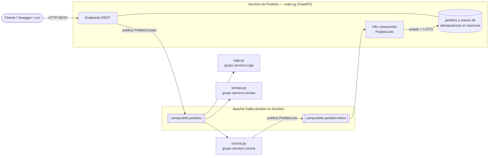
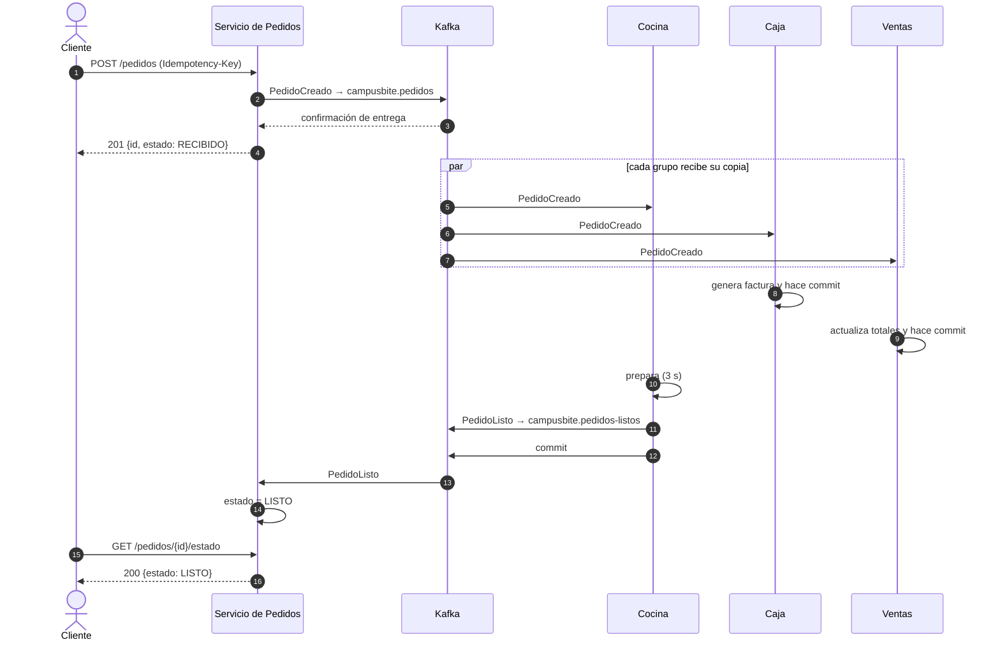
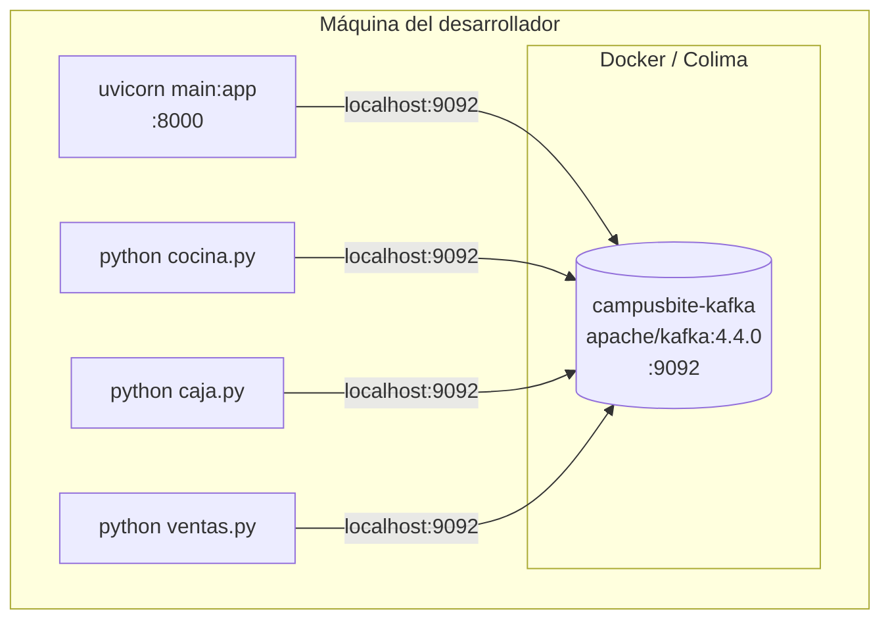

# Arquitectura de CampusBite

## 1. Contexto y objetivo

CampusBite es un sistema distribuido de pedidos para la cafetería del campus. Los estudiantes registran un pedido y consultan su estado. Mientras tanto, la cocina lo prepara, la caja lo factura y ventas lleva las estadísticas.

El sistema se divide en servicios independientes que se comunican por mensajes. Así, la caída de una parte (por ejemplo, la cocina) no impide que el resto siga funcionando ni hace que se pierdan pedidos.

**Requisitos que guían la arquitectura:**

- Un cliente debe poder crear un pedido y consultar su estado de forma síncrona.
- Cocina, Caja y Ventas deben recibir **todos** los pedidos, cada uno de forma independiente.
- Si un servicio está caído, sus pedidos deben quedar pendientes y procesarse cuando vuelva.
- Un reintento del cliente o una entrega repetida de un mensaje no debe crear pedidos ni facturas duplicados.

## 2. Vista de componentes



| Componente | Archivo | Responsabilidad | Produce | Consume (grupo) |
|---|---|---|---|---|
| Servicio de Pedidos | `main.py` | Expone la API REST, valida, aplica la idempotencia y guarda el estado de los pedidos | `PedidoCreado` → `campusbite.pedidos` | `campusbite.pedidos-listos` (`servicio-pedidos`) |
| Cocina | `cocina.py` | Prepara el pedido (simulado con 3 s) y avisa que está listo | `PedidoListo` → `campusbite.pedidos-listos` | `campusbite.pedidos` (`servicio-cocina`) |
| Caja | `caja.py` | Genera la factura del pedido | — | `campusbite.pedidos` (`servicio-caja`) |
| Ventas | `ventas.py` | Cuenta pedidos y unidades vendidas (en total y por producto) | — | `campusbite.pedidos` (`servicio-ventas`) |
| Broker | `docker-compose.yml` | Guarda los eventos y los offsets de cada grupo | — | — |
| Productor Kafka | `kafka_config.py` | Publica eventos y espera la confirmación del broker | — | — |

## 3. Comunicación

El sistema combina dos estilos de comunicación. La justificación está en los ADR (sección 8).

| Tramo | Estilo | Mecanismo | Por qué |
|---|---|---|---|
| Cliente ↔ Servicio de Pedidos | Síncrono, petición-respuesta | REST sobre HTTP (FastAPI) | El cliente necesita una respuesta inmediata: el id del pedido y su estado |
| Servicio de Pedidos → Cocina, Caja y Ventas | Asíncrono, publicación-suscripción | Apache Kafka | Desacopla los servicios: el pedido queda guardado aunque el consumidor esté caído |
| Cocina → Servicio de Pedidos | Asíncrono, por eventos | Apache Kafka | La cocina no necesita conocer la API; solo publica que el pedido terminó |

### API REST

| Método | Ruta | Descripción | Respuestas |
|---|---|---|---|
| `GET` | `/salud` | Comprueba que el servicio está vivo | 200 |
| `POST` | `/pedidos` | Crea un pedido. Requiere el header `Idempotency-Key` | 201 creado · 422 datos inválidos o falta el header · 503 Kafka no disponible |
| `GET` | `/pedidos/{pedido_id}/estado` | Consulta el estado del pedido | 200 · 404 no existe |

El cuerpo de `POST /pedidos` es `{"producto": str (1–100 caracteres), "cantidad": int (1–100)}`.

### Topics y eventos

| Topic | Evento | Productor | Consumidores |
|---|---|---|---|
| `campusbite.pedidos` | `PedidoCreado` | Servicio de Pedidos | Cocina, Caja, Ventas |
| `campusbite.pedidos-listos` | `PedidoListo` | Cocina | Servicio de Pedidos |

```json
// PedidoCreado
{"eventId": "uuid", "pedidoId": "uuid", "tipo": "PedidoCreado", "version": 1, "producto": "cafe", "cantidad": 2}

// PedidoListo
{"eventId": "uuid", "pedidoId": "uuid", "tipo": "PedidoListo", "version": 2, "estado": "LISTO"}
```

- **Clave del mensaje:** el `pedidoId`. Kafka envía los mensajes con la misma clave a la misma partición, así que los eventos de un mismo pedido llegan en orden.
- **`eventId`:** un identificador único por evento, que los consumidores usan para detectar mensajes repetidos.

## 4. Flujo de un pedido



Estados de un pedido: `RECIBIDO` → `LISTO`.

## 5. Mecanismos de sistemas distribuidos aplicados

| Mecanismo | Dónde | Qué resuelve |
|---|---|---|
| **Publicación-suscripción con grupos de consumidores** | Un `group.id` distinto por servicio | Cada servicio recibe todos los pedidos y lleva su propio avance |
| **Confirmación manual del offset** (`enable.auto.commit: False`) | Los 4 consumidores | El mensaje se confirma **después** de procesarlo, así un fallo a mitad no pierde el pedido (*at-least-once*) |
| **Consumidores idempotentes** (`eventId`) | Cocina, Caja y Ventas | Ignoran los eventos repetidos que trae *at-least-once*. En el Servicio de Pedidos, poner `LISTO` es idempotente por naturaleza |
| **Idempotency-Key** | `POST /pedidos` | Si el cliente reintenta la misma petición, recibe el pedido original en lugar de crear otro |
| **Confirmación de entrega del productor** | `kafka_config.py` | La API solo responde 201 cuando Kafka confirmó el evento; si no, responde 503 y el pedido no se guarda |
| **Identificadores globales (UUID)** | `pedidoId` y `eventId` | Se generan sin coordinarse con otros nodos y no chocan |
| **Validación en el borde** | Pydantic en `main.py` | Los datos inválidos se rechazan con 422 antes de llegar a Kafka |
| **Tolerancia a topic inexistente** | Los 4 consumidores | Los servicios pueden arrancar en cualquier orden |

## 6. Tolerancia a fallos

| Fallo | Comportamiento | Evidencia |
|---|---|---|
| Cocina caída | La API sigue aceptando pedidos; Caja y Ventas los procesan. Al volver, Cocina procesa los pendientes desde su último offset | [prueba-recuperacion-kafka.md](pruebas/prueba-recuperacion-kafka.md) |
| Caja o Ventas caídas | Igual que Cocina: cada grupo tiene su propio offset | Mismo mecanismo |
| Kafka caído | `POST /pedidos` responde 503 y no guarda el pedido. Los consumidores reintentan la conexión | Probado manualmente (503) |
| Mensaje entregado dos veces | Los consumidores lo ignoran por `eventId` | [duplicados-corregido.txt](pruebas/capturas/duplicados-corregido.txt) |
| Cliente reintenta el POST | Devuelve el mismo pedido gracias a `Idempotency-Key` | [prueba-idempotency-key.md](pruebas/prueba-idempotency-key.md) |

## 7. Despliegue



Cada servicio es un proceso independiente y todos se conectan al broker en `localhost:9092`. Kafka corre en modo KRaft con un solo nodo, sin ZooKeeper.

## 8. Decisiones de arquitectura (ADR)

- [ADR-001: API REST para la comunicación cliente–servicio](adr/ADR-001-rest.md)
- [ADR-002: Apache Kafka para la comunicación entre servicios](adr/ADR-002-kafka.md)
- [ADR-003: Selección de mecanismos de sistemas distribuidos](adr/ADR-003-seleccion-mecanismos.md)

## 9. Limitaciones conocidas

- **El estado vive en memoria.** Los pedidos, las claves de idempotencia, los `eventId` vistos y los totales de Ventas se pierden al reiniciar un servicio. En producción irían en una base de datos.
- **Un solo broker y una partición.** No hay replicación: si el contenedor de Kafka se borra, se pierden los eventos.
- **Idempotency-Key no es atómica.** Si llegan dos peticiones simultáneas con la misma clave, ambas pueden crear un pedido.
- **Hueco entre publicar y responder.** Si Kafka confirma después de los 2 s de espera, la API responde 503 aunque el evento sí se publicó. En ese caso los consumidores procesan un pedido que la API no tiene guardado.
- **El campo `version` no se usa** para descartar eventos desordenados.
- **No hay estado intermedio** como `EN_PREPARACION`.
